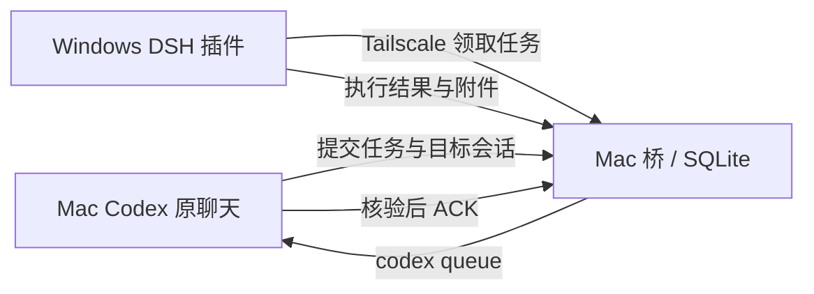

# Codex ↔ DSH Bridge

在 Mac 的 Codex 聊天里开发，让 Windows 桌面 DeepSeek Harness（DSH）执行任务，再把结果送回发起任务的原聊天。

无需公网 IP。两台设备通过 Tailscale 通信，Mac 运行 Python 标准库服务，Windows 加载 DSH 插件。项目不包含模型或应用，也不改变 Codex、DSH 的模型配置。

**状态：实验性开发工具，桥协议 4。** 支持会话发现与创建、持续对话、结果和附件回传、ACK 去重。Codex 回传使用 Queue：运行中排队，空闲后续作；自动 Steer 尚未实现。

## 一句话开始

先下载或克隆本仓库，在 Mac Codex 中打开它作为项目，然后复制下面这一句话：

> 请按本仓库 README 和 docs/INSTALL.md 帮我完成 Mac Codex 与 Windows DSH 通信桥的安装：先检查兼容版本和已有配置，带我完成 Tailscale 登录与双机连通验证，安装通用 skill 和后台服务，让我选择已有 DSH 会话或提供新会话的 Windows 工作目录及是否显式开启 Full access，逐步给出 Windows 操作，最后执行只读任务并确认结果回到当前 Codex 聊天且完成 ACK；保留已有通信、权限和个人 skill，遇到必须由我登录或操作的步骤再提示我。

这是**由 Codex 引导完成的安装流程**。账号登录、Windows 上的安装或重启仍需要本人操作；缺少兼容的应用接口时会停止并说明原因，不能仅靠 prompt 保证任意版本都可用。安装请求不授权覆盖已有桥、修改已有会话权限或执行业务任务。

## 能做什么

- 按标题或工作目录查找已有 Windows 会话，读取历史并连接。
- 在指定 Windows 工作目录创建会话，默认沿用 DSH 自身权限。
- 显式使用 `--full-access` 时，仅为此次新会话开启 Full access。
- 每条任务固定发起方 Codex ID 与目标 DSH ID，结果回到发起聊天。
- Windows 上传 Markdown、日志和截图，Mac 核验后 ACK；已 ACK 的通知跳过。
- 持久保存任务和结果，网络恢复后继续回传；投递不确定时不自动盲目重发。



附件接口目前为 **Windows → Mac**。Mac → Windows 可在任务中传入短文本，独立文件上传尚未实现。

## 安装与日常使用

完整流程：[安装、连通验证与卸载](docs/INSTALL.md)。更多命令见 [协议说明](docs/PROTOCOL.md)，发布边界见 [安全与私有数据](SECURITY.md)。

安装 skill 后，在其他 Codex 聊天里说：

> 使用 $windows-dsh，在 Windows 的 E:\project 中新建会话，沿用 DSH 默认权限，执行只读环境检查，把结果回传到当前聊天。

或继续已有会话：

> 使用 $windows-dsh，查找标题为“应用回归测试”的 Windows 会话，核对后连接，读取它最近的结果。

CLI 示例（初始化并连接后，在仓库目录执行）：

```sh
python3 bridge.py status
python3 bridge.py sessions --search '应用回归测试'
python3 bridge.py create --workspace 'E:\project'
# 仅在本人明确选择后使用：
python3 bridge.py create --workspace 'E:\project' --full-access
python3 bridge.py submit --file examples/smoke.json
```

`--state /实际私有目录` 是全局参数，放在子命令之前。默认目录为 `~/.local/share/codex-dsh-bridge`，不要把状态放入公开仓库。

## 兼容性与限制

| 组件 | 要求与验证边界 |
| --- | --- |
| Mac | Python 3.9+；桥与 Codex 使用相同系统用户和 Codex 数据目录 |
| Codex | 桌面所用 CLI 须支持 `queue --thread --message`；已实测 `0.162.0-alpha.17.2`，其他版本先检查 `queue --help` |
| Windows DSH | 须提供用户 profile patch、SessionController、tools、会话持久化和权限预设服务；同名版本不保证接口兼容 |
| Tailscale | 双机在线，策略允许 Windows 访问 Mac 的桥端口；不要求公网 IP |
| Windows 插件 | 查询和已有会话使用协议 2+；本发布版新建会话要求协议 4 |
| 回传 | 已验证应用开启、原聊天已加载时的 Queue 续作；关闭应用、休眠、未加载聊天不保证及时处理 |

任务在一台 Windows 上串行执行。当前用于单用户、单台 Windows，不包含多租户账号系统。权限继承不等于限制权限：DSH 自身默认值也可能是 Full access。

这是独立社区工具，非 OpenAI 或 DeepSeek 官方产品。兼容性须按实际接口检查。

## 开发与验证

Python 服务无 pip 依赖；插件使用 DSH 内置 Node，无额外 npm 依赖。开发测试需要独立 Node.js 20+。

```sh
python3 -m unittest discover -s tests -v
node --test tests/worker.test.mjs
# 有 PowerShell 时运行安装器隔离测试：
pwsh -NoProfile -File tests/setup.Tests.ps1
```

测试使用临时目录、模拟的 DSH 会话接口与本机 HTTP，不调用真实模型，不向真实 Codex 聊天投递。已有 DSH 构建目录时可额外运行：

```sh
node tests/dsh-runtime-smoke.mjs /实际路径/deepseek-harness
```

真实双机验收仍须按安装指南完成，发布版验证范围见 [验证记录](docs/VALIDATION.md)。

## 项目内容与许可证

```text
bridge.py                 Mac 服务与 CLI
windows/                  DSH 插件与安装/升级脚本
skills/windows-dsh/       可移植的 Codex skill
scripts/install-skill.py  安装 skill，保留已有不同内容
examples/                 不含机器凭据的任务示例
tests/                    本地测试
docs/                     安装、协议与验证说明
```

[MIT License](LICENSE)。第三方应用和服务遵循各自的许可与使用条件。

**只公开源码和通用示例。** `bridge.py bundle` 生成的 `windows.zip` 包含设备令牌，不能上传 GitHub Release；配置、数据库、日志、结果、附件与安装记录也不应公开。
